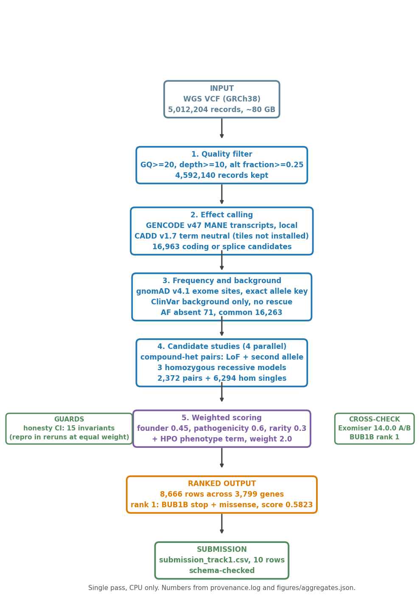

# MVA Hackathon 2026 - Track 1: variant prioritization

Team `fulopjoz` (individual). The task: find the disease-causing genotype in
one whole-genome sequencing dataset (about 80 GB, short reads) of a child
with a rare disease.

**Result: BUB1B p.Leu737Ter + p.Asn1002Lys, rank 1 of 8,666 candidates
(score 0.5823).** This is the clinically confirmed compound-heterozygous
diagnosis. The pipeline found it in one pass over 5,012,204 variants in
1 h 31 min on a 48-core workstation. Details: `REPORT.md` (also rendered as
`TRACK1_REPORT.pdf`).

## Deliverables

| File | What it is |
|---|---|
| `submission_track1.csv` | The submitted ranked-variants file (challenge schema) |
| `methods_description_FORM_FILLED.xlsx` | The required methods-description form |
| `REPORT.md` | Methods and results report |
| `TRACK1_TUNING_DISCLOSURE.md` | Scoring and calibration disclosure, required by the challenge rules |

## Reproduce

### 1. Create the environment

```bash
python3 -m venv .venv && . .venv/bin/activate
pip install pysam cyvcf2 pyyaml matplotlib
```

(Tested with Python 3.12. On hosts without a wheel for cyvcf2, install
htslib first or use `conda install -c bioconda cyvcf2`.)

### 2. Check the code (about one minute, no challenge data needed)

```bash
python3 pipeline/scripts/honesty_ci.py          # 15 invariants forge-and-check, must end "0 failure(s)"
python3 pipeline/scripts/annotate.py            # consequence-calling self-test
python3 pipeline/scripts/_hpo.py                # HPO scoring self-test
python3 checks/check_submission_schema.py       # schema + BUB1B-at-rank-1, "ALL CHECKS PASSED"
python3 figures/make_figures.py                 # rebuilds the diagram and all four data figures from figures/aggregates.json
```

The forge suite (`honesty_ci.py`) builds a small synthetic genome with
decoys and one strong LoF+missense sentinel pair, runs this exact pipeline
on it, and asserts that decoys cannot outrank the sentinel and that rank
order cannot depend on record order or phenotype tags. It uses no patient
data and runs anywhere.

`annotate.py` and `_hpo.py` check the annotation and phenotype-scoring
engines. Without the local reference files listed in
`pipeline/conf/track1_config.yml` they report a named SKIP and point to
`validation/*_selftest_dichtator.txt`, which records the same runs on the
analysis host verbatim (with the script's sha256). The stop_gained call at
the rank-1 locus is also confirmed independently of the pipeline by the
ClinVar record for allele ID 529272 (`nonsense`, Pathogenic) in the public
ClinVar release.

### 3. Check the results (simple terminal queries)

```bash
head -3 submission_track1.csv                                # rank 1 = chr15 BUB1B pair, epcr 0.5823
grep -c '^PROBAND01' submission_track1.csv                   # 10 rows
python3 -m json.tool figures/aggregates.json | head -30      # every number in the figures
grep 'compound_het_pairs\|vcf_in\|coding_or_splice' provenance.log   # 2,372 pairs; 5,012,204 -> 4,592,140 -> 16,963
```

`figures/aggregates.json` is the export of the ranked table: histogram
counts, medians, top-10, consequence counts. `figures/make_figures.py`
draws from this JSON plus `provenance.log` and the pipeline config only, so
what you see in the PNGs is exactly what is in those shipped text files.
`provenance.log` holds the run-time counters for every pipeline stage.

### 4. Full pipeline run

The complete pass takes the challenge VCF plus the public reference files
listed in `pipeline/conf/track1_config.yml` (GENCODE v47 MANE, GRCh38
fasta, gnomAD v4.1 exomes, ClinVar, HPO, OMIM gene-to-phenotype; the CADD
v1.7 tile set is optional - absent tiles make the score's CADD term neutral,
and the shipped run was made without them). With all references in place,
two commands produce the submission CSV:

```bash
# VCF -> ranked table (the single 1 h 31 min CPU pass; annotation, rarity
# join, pairing and scoring all happen inside this one command)
python3 pipeline/scripts/prioritize.py \
    --conf pipeline/conf/track1_config.yml --with-af --with-hpo \
    --out output/annot_full.tsv | tee prioritize.log

# ranked table -> submission CSV (10 rows, challenge schema)
python3 pipeline/scripts/make_submission_csv.py \
    --in output/annot_full.tsv --out submission_track1.csv
```

`prioritize.py` prints its stage counters (`[instrument] ...`) as it goes;
the shipped `provenance.log` recorded them for the run that produced the
submission file. The aggregates export for the figures is then:

```bash
python3 pipeline/scripts/export_aggregates.py output/annot_full.tsv > output/aggregates.json
```

## Validation artifacts

| File | What it shows |
|---|---|
| `pipeline/scripts/honesty_ci.py` | The 15 invariant suite described above |
| `validation/RERUN_VERIFICATION.txt` | Fresh end-to-end run of this repo's code on the challenge VCF (same stage counters as the production run) |
| `validation/EXOMISER_RUN.md` | Cross-tool check: Exomiser 14.0.0 on the same VCF also ranks BUB1B first with the same 8 HPO terms |
| `validation/PHASE_PROBE.md` (+ `phase_probe.sh`, `phase_probe_helpers/`) | Measured evidence that allele phase is unresolvable from this 150 bp library |
| `repro/desensitize.py` + `desensitization.json` | Re-derives all 8,666 stored scores from components, then re-ranks at HPO weights 0.0-2.0 |
| `provenance.log` | Run log: commands, counters, timestamps |


