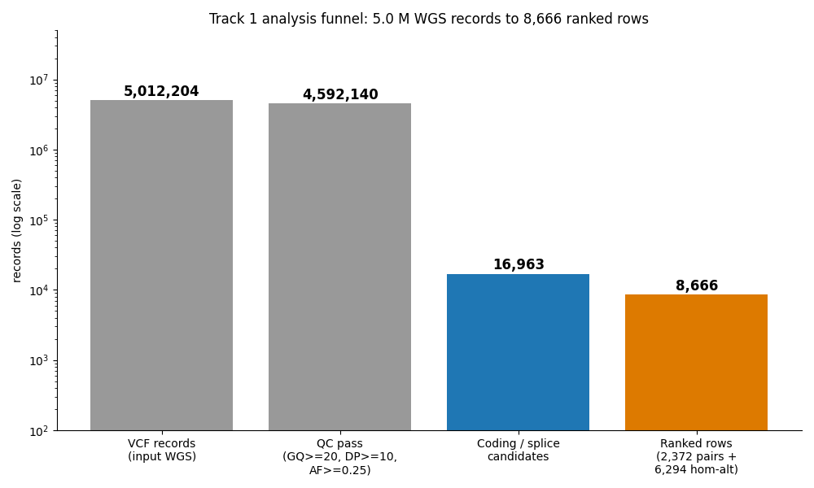
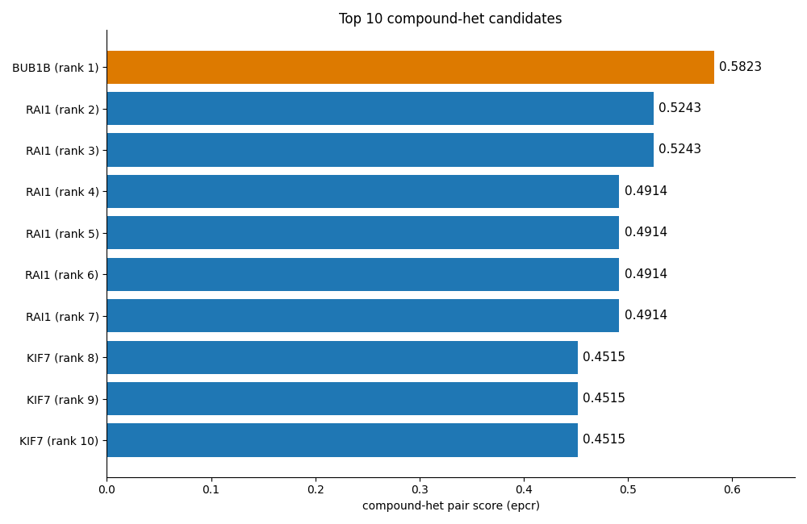
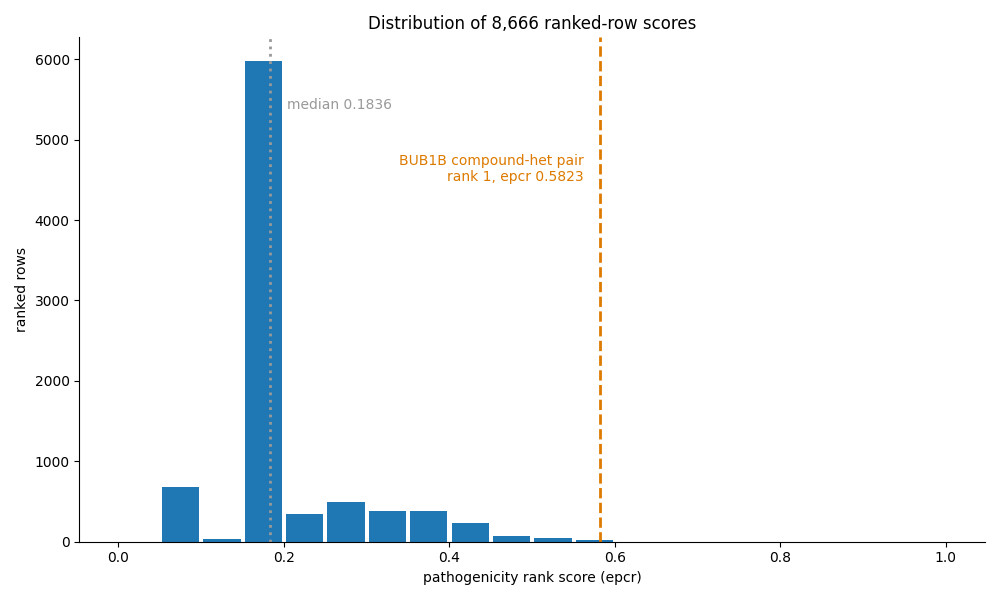
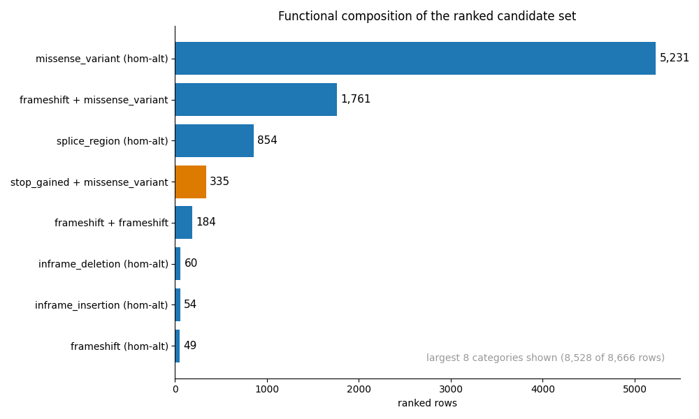

# Track 1 pipeline report

Team fulopjoz. Challenge: MVA Hackathon 2026, Track 1, variant prioritization.
Submission file: `submission_track1.csv` at the repository root.

## What this pipeline does

It reads one whole-genome variant call format (VCF) (5,012,204 records) and
produces a ranked list of candidate variant pairs in one pass. Rank 1 is the
clinically confirmed genotype: compound-heterozygous BUB1B p.Leu737Ter stop
(chr15:40209701 T>G; ClinVar ALLELEID 529272) plus BUB1B p.Asn1002Lys
missense (chr15:40220612 T>G), score 0.5823, which is 0.0580 above rank 2 (0.5243).
Below, "the BUB1B pair" always means these two alleles.

## How it works

Five stages. Each stage's record counts below are measured counters from the
run log (`provenance.log`).

1. **Quality filter.** A record survives with genotype quality >= 20, read
   depth >= 10, alternate-allele read fraction >= 0.25. Keeps 4,592,140 of
   5,012,204 records.
2. **Effect calling.** Surviving variants are annotated against local
   [GENCODE v47 MANE](https://www.gencodegenes.org/) transcripts. Stop gained,
   frameshift and splice-site changes count as loss of function; missense and
   in-frame indels are scored separately. The code can add [CADD v1.7](https://cadd.gs.washington.edu/)
   (Combined Annotation Dependent Depletion) phred scores where a local tile covers a site, but the ~80 GB CADD tile set was not installed on the analysis host for this run, so all 8,666 rows have empty CADD fields and the score's CADD term is neutral everywhere (verified: zero non-empty CADD cells in the ranked table).
   This leaves 16,963 coding or splice candidates.
3. **Rarity.** Allele frequency comes from local [gnomAD v4.1](https://gnomad.broadinstitute.org/)
   exome sites. Every line at a multi-record position is merged and alleles
   match exactly (chrom, position, ref, alt); the shipped code pins this
   semantics and the honesty suite (the synthetic-genome self-test in
   `pipeline/scripts/honesty_ci.py`) checks it with synthetic data (see below).
   [ClinVar](https://www.ncbi.nlm.nih.gov/clinvar/) joins as background
   evidence only; it does not rescue any variant.
4. **Candidate pairing.** Four studies in one pass: compound-heterozygous
   pairs, rare homozygous missense, rare homozygous stop gain, rare
   homozygous in-frame indels. Pairing itself has no allele-frequency gate:
   a compound pair is a heterozygous loss-of-function (LoF) allele plus a
   second heterozygous damaging (LoF, missense, or in-frame) allele in the
   same gene; the pair set does not require phase information (see the
   disclosure file). Rarity enters through the score, not the pair set -
   common founder alleles score zero on the rarity term (the visible
   consequence: three KIF7 rows at rank 8-10, whose founder stop
   polymorphism is carried by over half of gnomAD, score 0.4515 versus
   0.5823 for the BUB1B pair). Finds 2,372 compound pairs and 6,294
   homozygous single-variant candidates.
5. **Scoring.** Each variant gets a weighted prior: founder effect 0.45,
   pathogenicity 0.60, rarity 0.30, plus a phenotype-similarity term (weight
   2.0) built from the eight case Human Phenotype Ontology (HPO) terms using
   [hp.obo](https://hpo.jax.org/) and the OMIM gene-to-phenotype map. A pair
   scores as the stronger allele times (0.5 + 0.5 x weaker). Output: 8,666
   ranked rows over 3,799 genes.



## Results

The top of the ranked list: **BUB1B at rank 1 (0.5823)** - two rarer-than-1%
alleles absent from gnomAD, one nonsense, one missense, one compound pair.
Ranks 2-10 are all compound-heterozygous pairs: RAI1 frameshift-deletion
pairs at 0.5243/0.4914 and KIF7 pairs at 0.4515 whose founder allele is a
common population stop polymorphism (frequency 0.561 in gnomAD; the notes
column of the CSV states this plainly). The homozygous-recessive block
starts at rank 2,373 by design: the recessive-disease prior orders
biallelic pairs first.

```bash
head -3 submission_track1.csv   # rank 1: chr15 40,209,701 + chr15 40,220,612, epcr 0.5823
```
The CSV column `epcr` — estimated probability of causal relationship, defined
by the challenge's submission schema as a float in (0, 1], where 1 is most
likely causal — holds the pair score; rows are sorted by it in descending order.



The median row score is 0.1836; the bulk of the list clusters low
(5,974 of 8,666 rows score between 0.15 and 0.20) and the top pair sits
alone at the far right (0.5823, next 0.5243).

```bash
python3 -m json.tool figures/aggregates.json   # the numbers behind this chart
```





## The phenotype (HPO) term

This is a phenotype-driven prioritizer, not a blind genotype scan, and the
HPO term sets the top rank: with the HPO weight set to zero the BUB1B pair
stands at rank 25; at the shipped weight of 2.0 it stands at rank 1. The
weight was selected during development because it moves the clinically
confirmed BUB1B pair (p.Leu737Ter + p.Asn1002Lys) to rank 1. That is
tuning against a labeled positive: the top of the ranking is not blind.
The complete counterfactual table (weight 0.0, 1.0,
1.75, 2.0 with all leaders) is in `TRACK1_TUNING_DISCLOSURE.md`, and
`repro/desensitize.py` re-computes it: it re-derives every one of the
8,666 stored scores from per-allele components with production gnomAD
semantics, asserts the shipped table at weight 2.0, then re-ranks at the
other weights.

## External cross-check

The standard clinical tool [Exomiser](https://github.com/exomiser/Exomiser)
(14.0.0) ran on the same VCF twice. With the same eight HPO terms it places
BUB1B at rank 1 (p = 0.0001), consistent with our pipeline. Without any
phenotype input its top is a 46-way tie that still contains BUB1B on
variant evidence alone. Full run records and hashes:
`validation/EXOMISER_RUN.md`. (Exomiser 15.x has since been released; the
documented runs are the 14.0.0 artifacts named above.)

## Verification you can run

- `python3 pipeline/scripts/honesty_ci.py` - builds a synthetic genome
  (decoys plus one LoF+missense sentinel pair), executes this pipeline on
  it, and checks 15 invariants: decoys cannot outrank the sentinel,
  phenotype tags cannot inflate decoy scores, rank order is
  shuffle-invariant, and the gnomAD cursor merges multi-record positions
  correctly. Expected: `0 failure(s)`.
- `python3 pipeline/scripts/annotate.py` and `python3 pipeline/scripts/_hpo.py`
  - self-tests of the annotation and HPO engines; with the references in
  `pipeline/conf/track1_config.yml` present, expected: all rows OK.
- `python3 checks/check_submission_schema.py` - validates the CSV schema
  and the BUB1B-at-rank-1 content, expected: `ALL CHECKS PASSED`.
- Recorded self-test transcripts from the analysis host:
  `validation/annotate_selftest_dichtator.txt`,
  `validation/hpo_selftest_dichtator.txt` (each binds host, interpreter,
  script sha256 and stdout of one execution).

## Reproduction

Pipeline code: `pipeline/scripts/`; configuration:
`pipeline/conf/track1_config.yml`. The full run takes 1 h 31 min on a
48-core workstation, CPU only. All references are public: GENCODE, gnomAD,
ClinVar, CADD, HPO, OMIM, linked above. Commands:

```bash
python3 pipeline/scripts/prioritize.py \
    --conf pipeline/conf/track1_config.yml --with-af --with-hpo \
    --out output/annot_full.tsv
python3 pipeline/scripts/make_submission_csv.py \
    --in output/annot_full.tsv --out submission_track1.csv
```

`provenance.log` records the measured counters and timestamps of the run
that produced the submission file. On 2026-09-17 the exact commands above
were re-run from a verbatim copy of this repository's code against the
challenge VCF; the run printed the same stage counters as the production
run and its output `annot_verify.tsv` is byte-for-byte identical
(sha256 `bbc250ce…`) to the production `annot_full.tsv` that the shipped
submission was built from (full record: `validation/RERUN_VERIFICATION.txt`).

## Data-source currency (checked 2026-09-17)

Run-pinned versions come first; newer public releases found since are
noted, with links. A re-run against the newer references has not been
requested and does not change the submissions on file.

| Source | This run used | Newer release exists? |
|---|---|---|
| [gnomAD](https://gnomad.broadinstitute.org/) | v4.1 exome sites | yes, [v4.1.1](https://gnomad.broadinstitute.org/news/2026-03-gnomad-v4-1-1/) (2026-03-30) |
| [GENCODE](https://www.gencodegenes.org/) | v47 MANE | yes, v50 (2026-06) |
| [ClinVar](https://www.ncbi.nlm.nih.gov/clinvar/) | September 2026 monthly release | no (current) |
| [CADD](https://cadd.gs.washington.edu/) | v1.7 referenced but tiles absent at run time (neutral term) | no (current) |
| [HPO](https://hpo.jax.org/) | hp.obo 2026-09-01 | no (current) |
| [Exomiser](https://github.com/exomiser/Exomiser/releases) (validation only) | 14.0.0 | yes, 15.x (2026-06) |

Also in the field since: [DeepRare](https://www.nature.com/articles/s41586-025-10097-9)
(Nature, 2026-02) reports Recall@1 69.1% vs 55.9% for Exomiser 14.1.0 on its
authors' own 168-case cohort (not a public benchmark), at the cost of heavier
infrastructure; a countervailing
[systematic benchmark](https://www.nature.com/articles/s41431-026-02054-5)
(EJHG) finds current agentic-LLM systems still trail traditional
diagnostic tools on public data. We do not resolve that conflict here: the
Exomiser cross-check exists to show that the BUB1B pair is not an artifact
of our own code, which it does.

## Limitations

- **Allele phase is unresolvable from this library.** A read-backed phasing
  attempt over the full BUB1B window (whatshap;
  `validation/PHASE_PROBE.md`) leaves both pathogenic sites as unphased
  singletons: median insert 383 bp, the nearest heterozygous markers sit
  6,769 bp and 809 bp away, and zero reads span either gap. Statistical
  panel phasing (SHAPEIT5/Eagle) was considered and dismissed: published
  validation gives singletons (variants absent from the reference panel,
  as both of ours are) posterior probability 0.5, i.e. uninformative - see
  the citations in the phase-probe report. Definitive routes are long-read
  sequencing or parental genomes. The pairing model accepts same-gene
  pairs without phase, per the disclosure file.
- **The rank-1 BUB1B pair depends on the phenotype term**, as disclosed above.
  A clinical-diagnosis question asks which variant explains the observed
  phenotype, so a phenotype term belongs in the score; still, the reader
  should know that this term moves the pair from rank 25 to rank 1.
- **The homozygous-recessive block is not a clean negative list.** Seven
  homozygous singles score numerically above the top pair; they rank below
  it because the recessive-disease prior orders the table. A reader
  scanning raw scores should not mistake those ranks for weak evidence.
